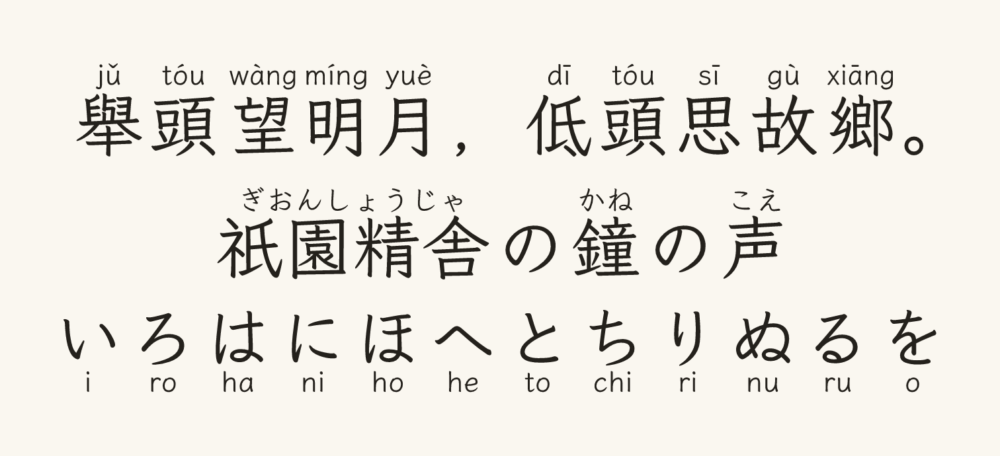

# Rubify

> Annotate fonts with ruby (pinyin/romaji/furigana) and produce modified TTF/WOFF2 outputs.

- Render ruby annotations using pluggable renderers (`pinyin`, `romaji`, `hiragana`)
- Word-level readings through bundled dictionaries, compiled into ligature and
  contextual rules, so 日本 reads にほん and 今日
  reads きょう instead of per-character readings
- Subset output fonts to only include annotation characters
- Optionally split TTC into individual TTF files
- Optional WOFF2 output (feature-flagged, currently only supported when splitting collections)

## Library Usage

See the [rubify](https://docs.rs/rubify) crate documentation for API details and examples.

## CLI Usage

```sh
rubify <input-file-or-glob> -o <out-dir> --ruby <pinyin|romaji|hiragana> [options]
```

- `--out, -o <path>`: Output directory (required)
- `--ruby <pinyin|romaji|hiragana>`: Which annotation renderer to use (requires building with the corresponding feature)
- `--font <path>`: Separate font file to use for ruby characters
- `--words <path>`: Word list file, added on top of the bundled dictionary.
- `--dict <path>` / `--no-dict`: Use a compiled dictionary file instead of the
  bundled one / use no bundled dictionary
- `--bare <form>`: Leave a form bare (repeatable)
- `--subset`: Subset output font to contain only annotated characters
- `--split`: When input is a TTC, write each font as a separate TTF file instead of rebuilding a TTC
- `--woff2`: Convert outputs to WOFF2
- `--position <top|bottom|leftdown|leftup|rightdown|rightup>`: Where to place ruby annotations relative to the base glyph. Valid values:
  - `top` (default): place annotation above the base glyph
  - `bottom`: place annotation below the base glyph
  - `leftdown`: place annotation to the left, stacking downwards
  - `leftup`: place annotation to the left, stacking upwards
  - `rightdown`: place annotation to the right, stacking downwards
  - `rightup`: place annotation to the right, stacking upwards
- `--fit`: Squeeze ruby horizontally so it stays inside the annotated
  character (or the whole word) when there is no room
- `--fit-floor <ratio>`: Lowest scale the fitting ruby is squeezed to;
  below it the ruby overhangs (default 0, which fits exactly)
- `--adjust-metrics`: Raise the ascender so ruby is not clipped by tight
- `--common-only`: Annotate only words in the frequency window
  line spacing
- `--no-places`, `--no-untagged`: Drop place names / unranked words
- `--skip-jlpt <N5..N1>`: Leave words of that level and easier bare
- `--nf-min <n>` / `--nf-max <n>`: Newspaper frequency bucket window
- `--select-tags <tags>`: Comma separated JMdict priority tags that select a
  word whatever its bucket
- `--min-tatoeba <n>`: Tatoeba uses that select a word whatever its bucket
- `--scale <ratio>`: Ruby size relative to the base characters
- `--gutter <em>`: Space between the base glyph and the ruby
- `--offset <em>`: Baseline offset for the ruby
- `--tight`: Per-character placement instead of a shared baseline

### Examples

```sh
rubify Sarasa-Regular.ttc -o dist --ruby pinyin --split
```

```sh
rubify *.ttc -o dist --font iosevka/IosevkaSlim-Regular.ttf --ruby romaji --position bottom --split --woff2
```

```sh
# Furigana from the bundled Japanese dictionary, with place names
rubify NotoSansJP-Regular.ttf -o dist --ruby hiragana --common-only
```



## Word annotations

With a dictionary (bundled by default) or `--words`, rubify annotates whole
words rather than characters. Each word reading is drawn over the word and
made reachable with GSUB ligature and contextual rules under `liga` and
`rclt`, both enabled by default in browsers and shapers:

- 日本 reads にほん / nihon as a word, not 日 (ひ) + 本 (もと)
- 今日 reads きょう / kyō, not ki + yo + u
- 学校 reads がっこう / gak + kō, sokuon included
- Curated defaults win where the data ranks wrong (出来 is でき, not しゅったい)

A font only ever sees one run of characters at a time, so words that mix kanji
and kana (食べる) cannot be matched by any font and are skipped. Per-character
annotations remain the fallback for text no word matches.

Bundled data is CC BY-SA 4.0; see [data/LICENSE.md](data/LICENSE.md) and
`--no-dict`/`--dict` to avoid or replace it. The JA dictionary comes from
furifont's compiled JMdict data; the ZH dictionary from CC-CEDICT.

Ruby is drawn above the base glyphs and can be clipped by tight line spacing;
set `line-height` to about 1.6 in the application, or use `--adjust-metrics`.

A variable font is flattened to its default instance: rubify re-encodes the
glyphs it annotates, so the font's variation data (`gvar`, `HVAR`, `VVAR`) is
dropped with a warning.

## Fonts made with rubify

Typefaces that ship rubify-generated annotations:

- [Asterism Ruby](https://lem.my/fonts/asterism-ruby)

## Development

`example.png` is generated, not hand-drawn. `cargo xtask example` downloads a
pinned font, subsets it to the specimen, runs the annotation pipeline over it
and rasterizes the result:

```sh
cargo xtask example
```

The specimen (text, ruby sets and word readings) lives in
`xtask/src/example.rs`; it renders with
[LXGW WenKai](https://github.com/lxgw/LxgwWenKai) (SIL Open Font License 1.1).
The bundled dictionaries are rebuilt separately with `cargo xtask update-dict`.

## License

Licensed under either of

- Apache License, Version 2.0 ([LICENSE-APACHE](LICENSE-APACHE) or <https://www.apache.org/licenses/LICENSE-2.0>)
- MIT license ([LICENSE-MIT](LICENSE-MIT) or <https://opensource.org/licenses/MIT>)

at your option.

The bundled dictionaries are licensed under CC BY-SA 4.0, see
[data/LICENSE.md](data/LICENSE.md).
